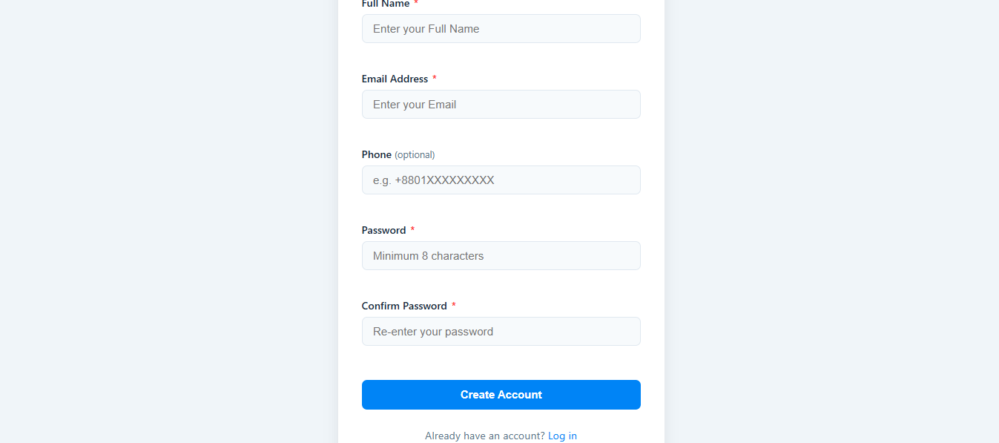
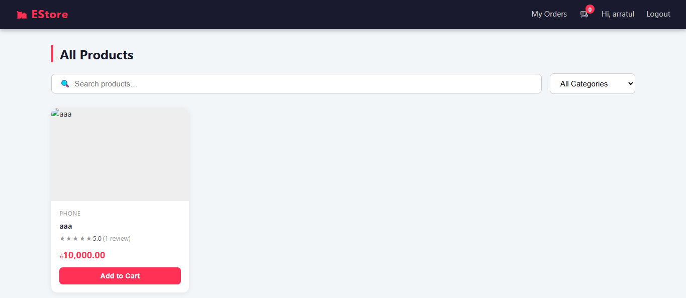
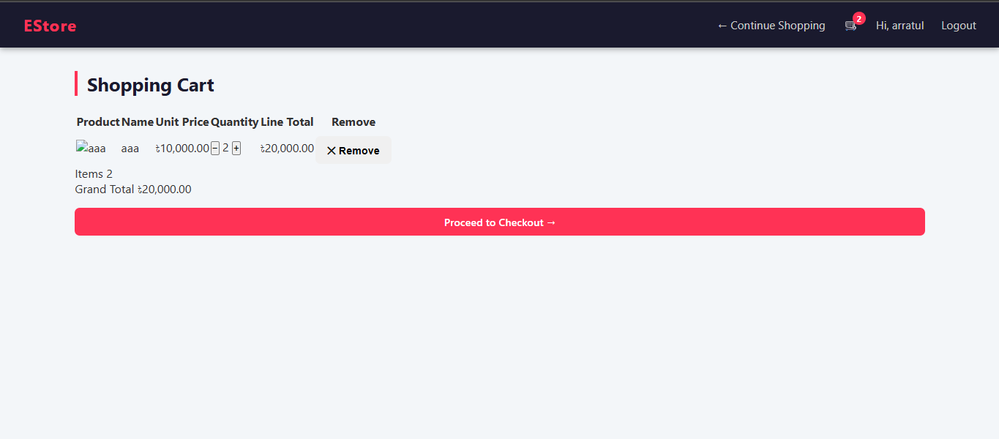
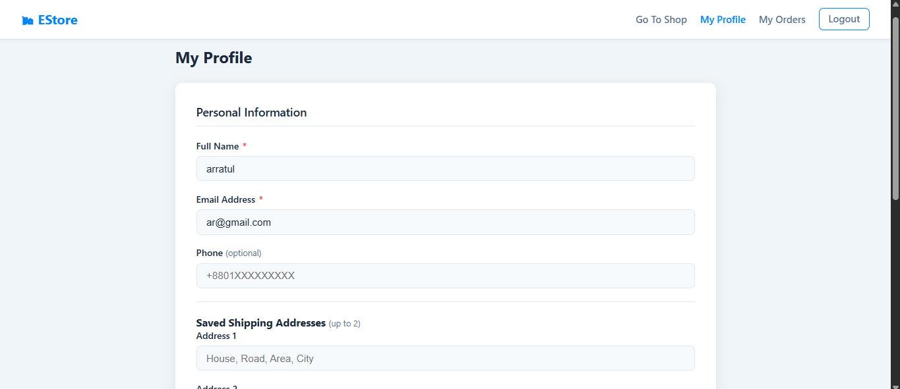
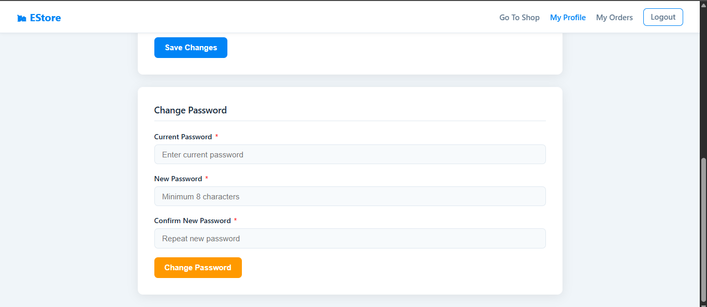
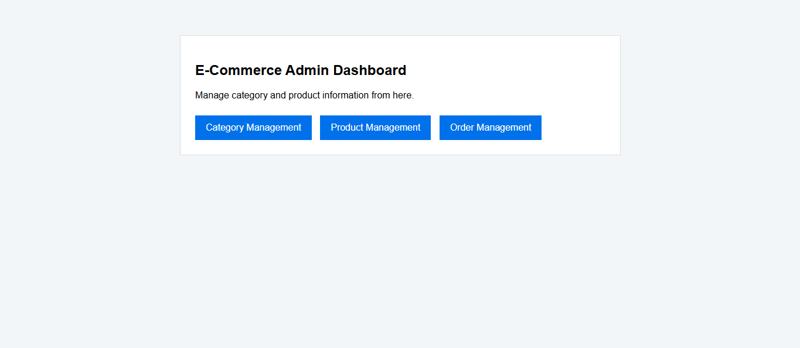
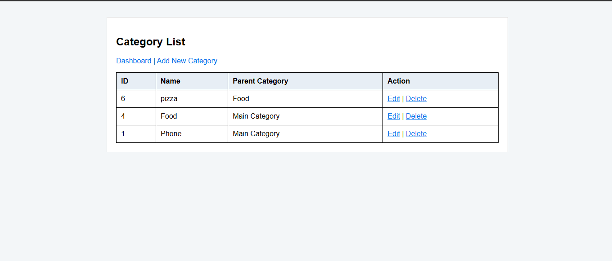
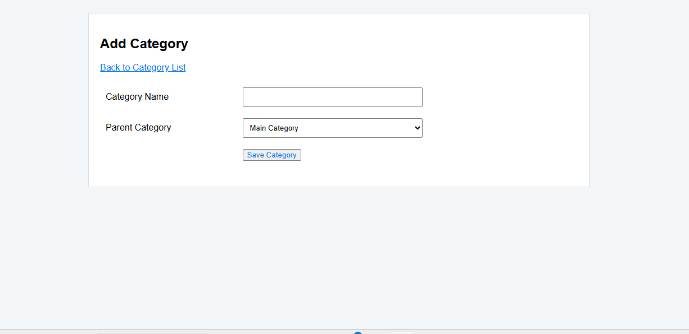
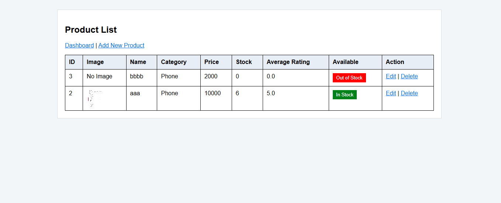
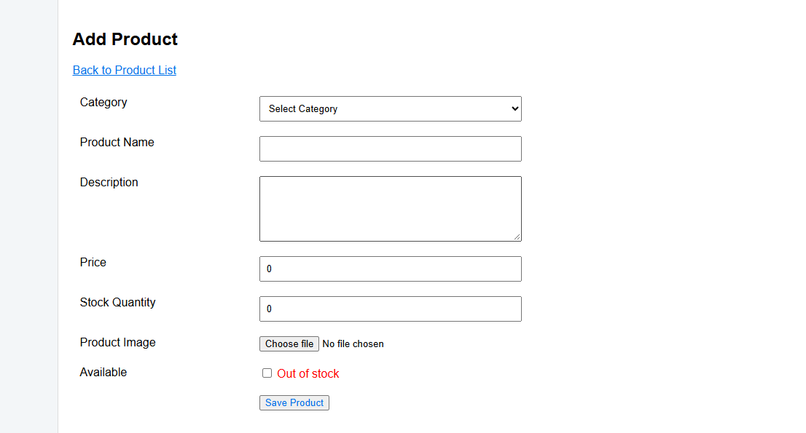

# EStore — E-Commerce Store

A PHP and MySQL e-commerce web application built as a **four-member Web Technologies course project**. EStore brings together customer authentication, an admin-managed product catalogue, a session-based shopping cart and checkout, and post-purchase order and review workflows.

The project uses an **MVC-style structure** with PHP controllers, models, and views, alongside HTML, CSS, JavaScript, AJAX, and MySQL.

> **Project context:** This repository is organized into four student modules (`S1`–`S4`) that use a shared database. Each module was developed as an individually assigned feature.

## Application screenshots

### Customer experience

**1. Registration** — Create a customer account with name, email, optional phone and password.



**2. Product catalogue** — Browse products with search, category selection, price, ratings and add-to-cart options.



**3. Shopping cart** — Review quantities, unit prices, line totals and the grand total before checkout.



**4. Customer profile** — Update personal details and manage saved shipping addresses.



**5. Change password** — Change a password by providing the current password and confirming the new one.



### Admin experience — Student 2

**6. Admin dashboard** — Navigate to category, product and order management.



**7. Category list** — View categories, their parent categories and edit/delete actions.



**8. Add category** — Create a new category and optionally choose its parent.



**9. Product list** — View product images, categories, prices, stock quantities, average ratings and availability badges.



**10. Add product** — Enter category, name, description, price, stock, image and availability information.



## Team modules

| Module | Assignment | Main responsibilities |
| --- | --- | --- |
| **S1 — Student 1** | Authentication & Profile | Registration, login, remember-me, sessions, customer profile, saved addresses and password changes |
| **S2 — Student 2** | **Product & Category Management (Admin)** | **Category CRUD, product CRUD, image upload, stock alerts, rating display and AJAX availability toggle** |
| **S3 — Student 3** | Shopping Cart & Checkout | Customer catalogue, AJAX search/filter, session cart, quantity adjustments, checkout and order confirmation |
| **S4 — Student 4** | Order Management & Product Reviews | Customer order history, admin order status updates and reviews of delivered products |

## Student 2 — My contribution

The **S2 module** provides the admin-facing tools that maintain the product catalogue used by customers.

### Category management

- Create, list and edit categories.
- Choose an optional parent category, supporting **one level of category nesting**.
- Prevent deletion when a category still has child categories or associated products.

### Product management

- Create, list and edit products with a category, name, description, price and stock quantity.
- Upload a primary image; the assignment specifies **JPEG/PNG, maximum 3 MB**, saved to `S2/public/uploads/products/`.
- Prevent deletion of products referenced by existing `order_items`.
- Highlight low-stock products when `stock_qty <= 5`.
- Show the average rating computed from the shared `reviews` table.
- Toggle product availability through JavaScript/AJAX without refreshing the entire page.

**Data provided to other modules:** `categories` and `products` records, product availability and stock quantities, and primary image paths. Customer browsing and checkout depend on these records.

### S2 folder structure

```text
S2/
├── Controller/
│   ├── JS/
│   │   └── availability.js
│   ├── CategoryController.php
│   └── ProductController.php
├── Model/
│   ├── CategoryModel.php
│   ├── ProductModel.php
│   └── db.php
├── public/
│   └── uploads/
│       └── products/
└── View/
    └── admin/
        ├── dashboard.php
        ├── dashboard.css
        ├── categories/
        │   ├── categoryList.php
        │   ├── categoryForm.php
        │   └── category.css
        └── products/
            ├── productList.php
            ├── productForm.php
            └── product.css
```

**MVC responsibilities:** Controllers handle requests, validation, redirects and AJAX responses; models handle database operations; views render pages, with styling in separate CSS files. `Model/db.php` contains the S2 database connection.

### How the modules connect

1. **S1** authenticates customers and admins and establishes the session/role used by restricted pages.
2. **S2** maintains products, categories, stock information, and image paths.
3. **S3** reads available products and creates orders and order items at checkout.
4. **S4** processes those orders and writes customer reviews that can be displayed against products.

## Technology stack

- **Frontend:** HTML, CSS, JavaScript, AJAX
- **Backend:** PHP
- **Database:** MySQL
- **Local server:** Apache via XAMPP
- **Architecture:** MVC-style organization
- **Database access:** MySQLi / PHP database connection (use prepared statements for user-supplied values)
- **State management:** PHP sessions for authentication and the cart

## Folder organization

```text
E-Commerce-Store/
├── S1/
│   ├── Controller/
│   ├── Model/
│   └── View/
├── S2/
│   ├── Controller/
│   │   ├── CategoryController.php
│   │   └── ProductController.php
│   ├── Model/
│   │   ├── db.php
│   │   ├── CategoryModel.php
│   │   └── ProductModel.php
│   ├── View/
│   └── public/
├── S3/
│   ├── Controller/
│   ├── Model/
│   └── View/
├── S4/
│   ├── Controller/
│   ├── Model/
│   └── View/
├── assets/
│   └── screenshots/
└── README.md
```

> The directory tree summarizes the structure shown during development. Additional files, stylesheets, scripts, and routes may be present in each module.

## Database overview

The modules share six primary tables:

| Table | Purpose |
| --- | --- |
| `users` | Customer/admin accounts, profile information and saved addresses |
| `categories` | Product categories and their parent/child relationships |
| `products` | Product details, category, price, stock, image, and availability |
| `orders` | Customer checkout and order status |
| `order_items` | Products, quantities, and prices associated with orders |
| `reviews` | Customer ratings and written reviews |

The shopping cart is maintained in `$_SESSION['cart']` rather than a dedicated database table.

## Running locally

### Prerequisites

- [XAMPP](https://www.apachefriends.org/) with Apache, PHP, and MySQL
- A modern web browser
- VS Code or another code editor (optional)

### Setup

1. Copy the repository folder to:

   ```text
   C:\xampp\htdocs\E-Commerce-Store
   ```

2. Start **Apache** and **MySQL** in the XAMPP Control Panel.
3. Open **http://localhost/phpmyadmin/** and create the database expected by your PHP connection files.
4. Import the project's SQL database export **if one is included**, or create the required shared tables using your team's schema. This README does not assume an SQL dump exists in the repository.
5. Check the database credentials and database name in the relevant connection files, such as `S1/Model/DatabaseConnection.php` and `S2/Model/db.php`.
6. Visit **http://localhost/E-Commerce-Store/** if a root entry point exists. Otherwise, open the actual login or catalogue PHP page under its module's `View/` directory.
7. Register or sign in, then explore the features available for your account role. Admin pages require an account with the admin role.

**Important:** Do not use the VS Code **Go Live** extension to execute PHP; open the application through Apache at `localhost` instead.

## Functional workflow

```text
Register / Login (S1)
       |
       +--> Customer --> Browse products (S3)
       |                    |
       |                 Add to cart
       |                    |
       |                 Checkout (S3)
       |                    |
       |                 My Orders (S4)
       |                    |
       |                 Review delivered items (S4)
       |
       +--> Admin --> Manage categories and products (S2)
                          |
                       Update availability / stock
                          |
                       Manage orders (S4)
```

## Validation and project rules

The course specification calls for server-side form validation, authenticated access to protected pages, prepared database queries, MIME type/size checks for uploads, JSON responses from AJAX endpoints, and safeguards against deleting records used by other modules. Review these rules when testing the integrated application.

## Screenshots and assets

The images in this README are stored in [`assets/screenshots/`](assets/screenshots/). Keep this directory when uploading to GitHub; otherwise the embedded images will not render.

> **Current screenshot note:** The catalogue and cart screenshots show a product image that does not load. Verify the stored image path and upload location before presenting this as a finished deployment.

## Academic context

Developed as a **Web Technologies** course project by a four-member team. The tasks were individually assigned to Students 1–4, with **Student 2 responsible for Product & Category Management (Admin)**.
